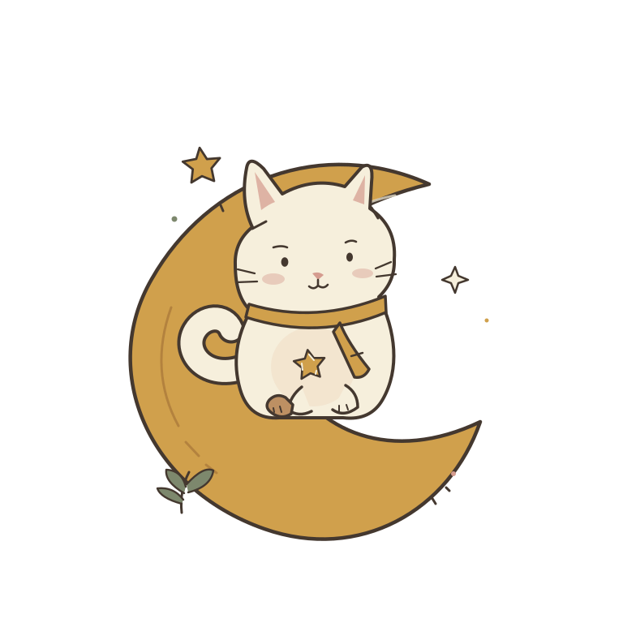

# Mooncat · 月白的小花园

一只戴着围巾的小猫，一座会自己长大的月球花园。

Mooncat 是 Windows 桌面陪伴程序：小猫可以沿着任务栏上方散步，花园可以安静地待在屏幕边缘。工作时交给月白照料花田，有空时再种花、摸猫、听一点舒缓的音乐。



## 可以做什么

- **桌边花园**：默认约 350 × 440 逻辑像素，拖动、置顶，或收进系统托盘。
- **小猫模式**：约 170 × 190 逻辑像素，点击猫咪听猫叫。花园与小猫模式切换时，窗口和画面一起过渡。
- **任务栏散步**：透明的原生猫咪窗口，不抢键盘焦点；走路、眨眼、甩尾、停下来休息。双击打开花园，右键可以暂停或隐藏。
- **慢慢种花**：播种、浇水、收获星光，买小摆件，给月白喂小鱼干；也可以开启月白托管，自动照料六块花田。
- **夜间观景站**：展开完整星空，召唤流星、连接猫咪星座、写心愿。
- **舒缓声音**：原创 66 BPM、16 小节钢琴与暖垫音乐；本地猫叫录音、种花和收获反馈。音乐由你主动开启。

花田、叶片、星光和小猫都有细微的运动。程序遵循系统减少动态效果的偏好。

## 使用

在 Windows 10/11 x64 上运行构建产物 `Mooncat.exe`。无需启动服务器，也不会打开外部浏览器。运行时需要 .NET Framework 4.8 和 Microsoft WebView2 Evergreen Runtime；多数 Windows 电脑已经具备这些组件。

如果程序提示缺少 WebView2，可以从 [Microsoft 官方页面](https://developer.microsoft.com/microsoft-edge/webview2/) 安装 Evergreen Runtime。

程序关闭按钮会把花园收进托盘。完整退出请使用托盘或小猫右键菜单里的退出。首次运行不注册开机启动。

## 从源码构建

在 Windows PowerShell 中，从仓库根目录运行：

```powershell
& .\desktop\install-sdk.ps1
& .\desktop\build.ps1 -OutputPath .\dist\Mooncat.exe
```

SDK 安装脚本从官方 NuGet 下载固定版本 `Microsoft.Web.WebView2 1.0.4258.31`，验证包 SHA256 和 Microsoft 原生加载器签名。构建使用 Windows 自带的 .NET Framework C# 编译器，把页面、音乐实现、插画和 SDK 可分发组件嵌入同一个 EXE。

已经提交绘制好的 PNG 和 SVG，因此正常 EXE 构建不需要 Node.js。若要重新生成原创插画和八帧猫咪行走图：

```powershell
npm install
npm run art
```

美术脚本只使用 `sharp`，固定版本见 `package.json`。完整编译步骤、测试命令和原生消息接口见 [desktop/BUILD.md](desktop/BUILD.md)。

## 项目结构

```text
app/                         离线页面、花园、音乐及原创素材
desktop/Mooncat.cs           WinForms 窗口、托盘、WebView2 离线宿主
desktop/RoamingCat.cs        GDI+ 透明桌宠和任务栏上方移动
desktop/build.ps1            构建单文件 EXE
desktop/install-sdk.ps1      下载并校验固定版本 SDK
scripts/draw-mooncat.cjs     原创插画和行走帧的可编辑源文件
.github/workflows/           Windows 构建、校验和及 tag 发布
```

界面在离线 WebView2 中渲染，桌宠本身是独立的原生透明窗口。原生宿主只接收可信的 `https://mooncat.local` 页面消息，并阻止其他域名的网络请求。宿主没有向页面开放 shell、任意文件访问或执行命令的接口。

## 保存与后续更新

存档只留在这台电脑，位置为 `%LOCALAPPDATA%\Mooncat\MoonGarden`。花园、心愿与声音偏好保存在 `save-profile`；窗口位置、置顶与桌宠偏好保存在 `desktop-window.json`。更新 EXE 时，新素材提取到新的哈希目录，继续使用原有存档和离线站点地址。

当前版本使用手动更新：退出旧版、运行新版。仓库没有自动下载器。后续改动请更新 [CHANGELOG.md](CHANGELOG.md)，在本地验证后提交。GitHub Actions 在 main、Pull Request 或手动触发时生成构建产物；首次 main 构建成功后创建 `v0.1.0` Release，附带 EXE 和校验和。后续 main 构建保留已发布版本，推送新的 `v*` tag 可发布新版本。

## 参与改进

欢迎通过 Issue 提交建议，通过 Pull Request 改进动效、花园玩法、音频或 Windows 体验。提交前请先验证源码可编译；修改原生交互时，使用隔离测试存档执行 smoke test，不要覆盖日常存档。新增素材请注明来源和许可证。

## 许可

原创程序代码、矢量插画、行走动画与音乐实现采用 [MIT](LICENSE)。猫叫录音采用 CC0；Microsoft WebView2 组件保留 Microsoft 的许可，详见 [THIRD_PARTY_NOTICES.md](THIRD_PARTY_NOTICES.md)。项目没有使用《星露谷物语》的代码、角色、素材或音乐。

首个公开版本为 `v0.1.0`；本版未进行代码签名。CI 固定 SDK 和 Actions 版本、公开 SHA256，提供可复现的构建流程；由于编译器和 ZIP 时间戳，独立构建的 EXE 不保证逐字节相同。
